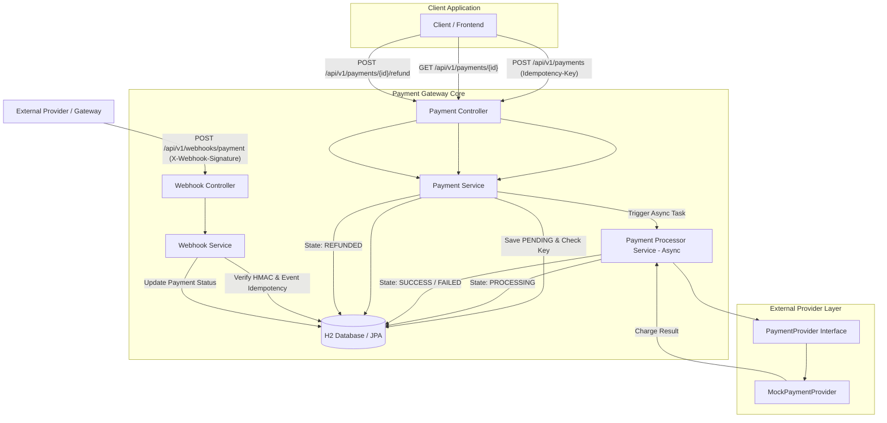

# Production-Ready Payment Gateway with Async Processing & Webhooks

A robust, enterprise-grade RESTful Payment Gateway built with **Spring Boot 3.x**, **Java 21**, **Spring Data JPA**, and **H2 Database**. Designed with clean architecture principles, asynchronous background processing, strict idempotency controls, HMAC SHA-256 webhook signature verification, and abstract payment provider interfaces.

---

## 🌟 Key Features

- **Asynchronous Payment Processing**: Payments transition state (`PENDING` → `PROCESSING` → `SUCCESS` / `FAILED`) asynchronously via Spring `@Async`.
- **Strict Idempotency**: Header-based `Idempotency-Key` validation ensuring duplicate requests return cached execution states without re-charging customers.
- **Provider Abstraction**: Decoupled `PaymentProvider` interface allowing seamless integration of providers (e.g., Stripe, PayPal, Razorpay) without altering domain logic.
- **HMAC SHA-256 Webhooks**: Secure webhook ingestion with `X-Webhook-Signature` verification and duplicate event deduplication using `eventId`.
- **Payment Refunds**: State machine enforcement permitting refunds only for `SUCCESS` payments (`REFUNDED`).
- **Pagination & History**: Paginated REST API for retrieving payment transaction logs.
- **Bean Validation & Error Handling**: Centralized `@RestControllerAdvice` delivering standardized JSON error responses.
- **Comprehensive Testing**: Full coverage via JUnit 5, Mockito, and Spring `MockMvc` integration tests.
- **Docker Support**: Containerized multi-stage Docker setup for production deployment.
- **Swagger / OpenAPI Documentation**: Interactive API documentation at `/swagger-ui.html`.

---

## 🏗️ System Architecture



---

## 🚀 Quick Start & Local Execution

### Prerequisites
- **Java 21 JDK**
- **Apache Maven 3.9+**
- **Docker** (Optional for container execution)

### 1. Run via Maven

To launch the application locally on port `8080`:

```bash
mvn clean spring-boot:run
```

- **API Base URL**: `http://localhost:8080`
- **Swagger UI**: `http://localhost:8080/swagger-ui.html`
- **H2 Console**: `http://localhost:8080/h2-console` (JDBC URL: `jdbc:h2:mem:paymentdb`, Username: `sa`, Password: *blank*)

### 2. Run Tests

To execute unit and integration test suites:

```bash
mvn clean test
```

### 3. Build & Run via Docker

```bash
# Build Docker Image
docker build -t payment-gateway .

# Run Container
docker run -p 8080:8080 payment-gateway
```

---

## 📑 API Specification & Examples

### 1. Create Payment
- **URL**: `POST /api/v1/payments`
- **Headers**:
  - `Content-Type: application/json`
  - `Idempotency-Key: <unique-uuid-or-key>`

#### Request Body
```json
{
  "amount": 499.99,
  "currency": "INR",
  "customerEmail": "customer@example.com",
  "description": "Premium Annual Subscription"
}
```

#### Response (201 Created)
```json
{
  "paymentId": "bdc99f10-f367-41e6-a117-627bd70654ff",
  "amount": 499.99,
  "currency": "INR",
  "customerEmail": "customer@example.com",
  "description": "Premium Annual Subscription",
  "status": "PENDING",
  "provider": null,
  "providerTransactionId": null,
  "idempotencyKey": "unique-key-123",
  "createdAt": "2026-10-06T15:19:54.144Z",
  "updatedAt": "2026-10-06T15:19:54.144Z"
}
```

#### Example cURL
```bash
curl -X POST http://localhost:8080/api/v1/payments \
  -H "Content-Type: application/json" \
  -H "Idempotency-Key: unique-key-123" \
  -d '{
        "amount": 499.99,
        "currency": "INR",
        "customerEmail": "customer@example.com",
        "description": "Premium Annual Subscription"
      }'
```

---

### 2. Get Payment Details
- **URL**: `GET /api/v1/payments/{paymentId}`

#### Response (200 OK)
```json
{
  "paymentId": "bdc99f10-f367-41e6-a117-627bd70654ff",
  "amount": 499.99,
  "currency": "INR",
  "customerEmail": "customer@example.com",
  "description": "Premium Annual Subscription",
  "status": "SUCCESS",
  "provider": "MOCK_PAYMENT_PROVIDER",
  "providerTransactionId": "mock_tx_745fd01e0c09",
  "idempotencyKey": "unique-key-123",
  "createdAt": "2026-10-06T15:19:54.144Z",
  "updatedAt": "2026-10-06T15:19:55.230Z"
}
```

#### Example cURL
```bash
curl -X GET http://localhost:8080/api/v1/payments/bdc99f10-f367-41e6-a117-627bd70654ff
```

---

### 3. List Payments (Paginated)
- **URL**: `GET /api/v1/payments?page=0&size=10`

#### Example cURL
```bash
curl -X GET "http://localhost:8080/api/v1/payments?page=0&size=10"
```

---

### 4. Refund Payment
- **URL**: `POST /api/v1/payments/{paymentId}/refund`

#### Response (200 OK)
```json
{
  "paymentId": "bdc99f10-f367-41e6-a117-627bd70654ff",
  "status": "REFUNDED",
  "amount": 499.99,
  "currency": "INR",
  "updatedAt": "2026-10-06T15:21:00.123Z",
  "message": "Payment refunded successfully"
}
```

#### Example cURL
```bash
curl -X POST http://localhost:8080/api/v1/payments/bdc99f10-f367-41e6-a117-627bd70654ff/refund
```

---

### 5. Ingest Webhook Event
- **URL**: `POST /api/v1/webhooks/payment`
- **Headers**:
  - `Content-Type: application/json`
  - `X-Webhook-Signature: <HMAC_SHA256_HEX>`

#### Request Body
```json
{
  "eventId": "evt_987654321",
  "type": "payment.succeeded",
  "paymentId": "bdc99f10-f367-41e6-a117-627bd70654ff",
  "providerTransactionId": "txn_ext_555"
}
```

#### Response (200 OK)
```json
{
  "eventId": "evt_987654321",
  "status": "PROCESSED",
  "message": "Webhook processed successfully"
}
```

#### Example cURL
*(Calculate HMAC SHA-256 using key `local-secret`)*

```bash
# Calculate signature (Linux/macOS bash example)
PAYLOAD='{"eventId":"evt_987654321","type":"payment.succeeded","paymentId":"bdc99f10-f367-41e6-a117-627bd70654ff","providerTransactionId":"txn_ext_555"}'
SIG=$(echo -n "$PAYLOAD" | openssl dgst -sha256 -hmac "local-secret" | awk '{print $2}')

curl -X POST http://localhost:8080/api/v1/webhooks/payment \
  -H "Content-Type: application/json" \
  -H "X-Webhook-Signature: $SIG" \
  -d "$PAYLOAD"
```

---

## 🛡️ Key Concepts & Design Decisions

### 1. Idempotency Implementation
- **Problem**: Network retries or client double-clicks can cause duplicate payment processing.
- **Solution**: The `PaymentService` checks the database for an existing `Payment` record matching the incoming `Idempotency-Key` header.
- If found, the service returns the existing `PaymentResponse` without executing provider APIs or creating duplicate database records.
- Database index on `idempotencyKey` enforces uniqueness at the persistence layer.

### 2. Webhook Security & Idempotency
- **HMAC Verification**: Webhooks enforce authenticity using HMAC SHA-256. The server re-computes HMAC on the raw JSON body using `WEBHOOK_SECRET` (`local-secret`) and compares it in constant time against `X-Webhook-Signature`.
- **Deduplication**: Every processed webhook event records its `eventId` in the `WebhookEvent` repository. Subsequent webhooks bearing identical `eventId` values return `SKIPPED_DUPLICATE` instantly.

### 3. Payment Provider Abstraction
- The core domain depends solely on the `PaymentProvider` interface (`charge(Payment payment)`).
- The `MockPaymentProvider` implementation simulates realistic network latency and provides deterministic outcomes (e.g. failing requests with amount `999.99` or description containing `"FAIL"`).
- Additional providers (e.g. `StripeProvider`, `RazorpayProvider`) can be plugged in via Spring `@Component` selection without altering core payment workflows.

### 4. Global Exception Model
All exceptions return standard JSON payloads matching the schema:

```json
{
  "timestamp": "2026-10-06T15:03:00.000Z",
  "status": 400,
  "error": "Bad Request",
  "message": "Validation failed: [amount: Amount must be greater than zero]",
  "path": "/api/v1/payments"
}
```

---

## 🧪 Test Coverage Matrix

| Test Suite | Focus Area |
| :--- | :--- |
| `PaymentServiceTest` | Payment creation, idempotency cache hit, null/blank header handling, refund state transitions, not found exceptions. |
| `WebhookServiceTest` | HMAC SHA-256 verification, `payment.succeeded` state update, duplicate event skipping. |
| `PaymentIntegrationTest` | Full HTTP roundtrip using `MockMvc`, validation HTTP 400, refund rule validation, header checks. |
